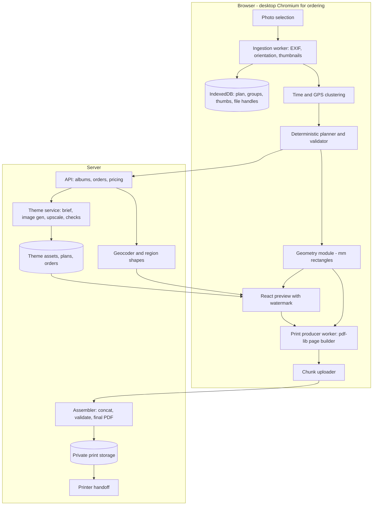

# Technical Plan — Travel Album V1

This document holds the engineering behind the specs in `openspec/specs/`. Specs say what the system must do; this says how it is built, why those choices, and what is likely to break. When they disagree, the spec wins and this document is updated.

Status: V1 design, pre-implementation. Dated decisions live in `docs/decisions.md`.

## 1. System shape



Two renderers, one geometry. The planner produces a plan; the geometry module turns plan plus layout library into millimetre rectangles; React draws them for preview and the print producer draws them into PDF pages. Neither renderer computes positions.

## 2. Repository layout

Monorepo with a small number of packages so the geometry and planner can be unit-tested without a browser.

```
apps/
  web/            React app: selection, preview, editing, production, upload
  api/            Server: albums, orders, pricing, theme, geo, assembler
packages/
  core/           Pure TypeScript, no DOM: plan types, layout library, geometry, planner, validator, pricing
  print/          Print producer: PDF page builder, image preparation, colour, fonts (runs in a Web Worker)
  theme/          Theme brief, prompt templates, acceptance checks, model adapter (runs on server)
docs/
openspec/
```

`packages/core` has no dependency on `apps/web` or on any image library. Everything in it is deterministic and tested with fixtures.

## 3. Data model

### Photo (local)

```ts
type Photo = {
  id: string;              // project-local, stable
  filename: string;
  fileRef: FileRef;        // File or FileSystemFileHandle wrapper
  type: 'jpeg' | 'heic' | 'png';
  bytes: number;
  width: number;           // orientation-corrected
  height: number;
  aspect: number;          // width / height
  orientationClass: 'landscape' | 'portrait' | 'square';
  exifOrientation: 1|2|3|4|5|6|7|8;
  colorProfile: 'srgb' | 'display-p3' | 'other' | 'untagged';
  takenAt?: string;        // ISO, local time as captured
  takenAtSource: 'exif' | 'itinerary' | 'neighbor' | 'sequence';
  gps?: { lat: number; lon: number };
  clusterId?: string;
  sequence: number;        // selection order
  thumbKey: string;        // IndexedDB key for the <=1600 px thumbnail
};
```

### Plan

```ts
type Plan = {
  albumId: string;
  version: number;
  trimMm: number;          // 210
  binding: 'softcover' | 'hardcover';
  density: 'spacious' | 'balanced' | 'compact';
  themeId: string;
  cover: { photoId: string; template: CoverTemplateId; title: string; dates: string };
  opening: SinglePage;     // right page, uses right half of a background
  spreads: Spread[];
  closing: SinglePage;     // left page, uses left half of a background
  groups: SpecialGroup[];
  padding: 'none' | 'colophon' | 'blank';
};

type Spread = { background: 'A' | 'B' | 'C'; left: PagePlan; right: PagePlan };
type PagePlan = { layoutId: string; photoIds: string[]; text?: TextBlock; groupId?: string };
type SinglePage = { backgroundHalf: { variation: 'A'|'B'|'C'; half: 'left'|'right' } } & PagePlan;
type SpecialGroup = { id: string; name?: string; photoIds: string[]; style: 'justified-5'|'justified-6'|'justified-8'|'justified-10'; anchorPhotoId: string };
```

### Geometry output

```ts
type PageGeometry = {
  pageIndex: number;       // 1-based inner page, or 'cover-front' etc.
  trimMm: number;
  bleedMm: number;
  photos: { photoId: string; x: number; y: number; w: number; h: number }[];  // mm from trim origin
  text: { kind: 'title'|'section'|'date'|'label'; x; y; w; h; content: string }[];
  decor: { kind: string; x; y; w; h }[];
  map?: { x; y; w; h; pins: MapPin[]; route: MapPoint[] };
  background: { variation: 'A'|'B'|'C'; half: 'left'|'right' };
};
```

## 4. Ingestion

Runs in a Web Worker to keep the UI responsive.

1. User selects files with `showOpenFilePicker` (Chromium) or `<input type=file multiple>` elsewhere.
2. For each file, sequentially:
   - Read EXIF with `exifr` (date, GPS, orientation, ICC/colour tag). HEIC metadata is also readable by `exifr`.
   - Decode a thumbnail. JPEG and PNG: `createImageBitmap(file, { resizeWidth, resizeQuality: 'high' })` with orientation `from-image`. HEIC: decode with a WASM decoder (`libheif-js`), then resize on an `OffscreenCanvas`. One decode at a time; a semaphore of 1 is enough on a laptop and avoids the 100-decodes-at-once failure.
   - Store the thumbnail as a JPEG blob (~quality 0.85) in IndexedDB; store the `Photo` record.
3. Persist `FileSystemFileHandle`s on Chromium. On reload, call `queryPermission`; if `prompt`, show a single "Reconnect your photos" button that calls `requestPermission` inside the click handler.
4. Elsewhere, on reload ask for reselection and match by `(filename, bytes, takenAt)`.

Missing metadata resolution order and the five-question cap are in the spec. Implementation: after neighbor and itinerary passes, find remaining undated runs; sort runs by length descending; ask about the largest runs first until the cap.

## 5. Clustering

On device, before planning.

- Time: sort by `takenAt`; split a moment when the gap exceeds `max(45 min, median gap * 4)`. The adaptive factor keeps a slow café afternoon together and separates a drive.
- Location: among photos with GPS, greedy centroid clustering with radius 2 km (walkable area). A time moment is also split when it contains two location clusters more than 10 km apart.
- Cluster centroids are the only coordinates sent to the server (for map pins and optional reverse geocoding). Per-photo GPS never leaves the device.

## 6. Planner

Pure function in `packages/core`. Inputs: `Photo[]`, `SpecialGroup[]`, density, layout library, trim, binding. Output: `Plan`.

Steps:

1. Build the ordered sequence: moments in time order; each special group is pulled out of the stream and reinserted as one opaque unit at the position of its anchor photo (default: its earliest).
2. For each moment, choose page fills. Density gives a target photos-per-page distribution and layout family weights:
   - Spacious: hero 35%, two 40%, hero+1 20%, three 5%, four 0%
   - Balanced: hero 15%, two 35%, hero+2 or three 40%, four 10%
   - Compact: hero 5%, two 25%, three 40%, four 30%
3. Greedy fill with lookahead of 2 pages: for the next k photos (k in 1..4), enumerate layouts whose orientation pattern accepts them and whose minimum-size check passes; score by (density weight, variety penalty against the previous two pages, orientation fit, whether the moment boundary lands on a page boundary). Take the best; continue.
4. Hero promotion: first photo of a moment gets a hero bonus; aspect wider than 2.2 forces hero.
5. Special groups: justified-row packing per page (Knuth-style line breaking over aspect ratios with target row height; standard "linear partition" approach). Capacity per style; overflow continues on the next spread.
6. Pair pages into spreads. Background alternates A, B, C, A... Opening page is the first page (right); closing page is the last (left). If the content page count is odd, append a colophon page before pairing. Apply the printer multiple.
7. Validate. The validator is a separate pure function and is run on every plan, including after each user edit.

Determinism: no `Math.random`, no `Date.now`, stable sorts with explicit tie-breakers (`takenAt`, then `sequence`, then `id`).

Edits re-pack only the touched pages: moving a photo re-runs steps 3–4 for the source and destination pages; everything else is left as-is, then step 6 re-runs for parity.

## 7. Layout library and geometry

Layouts are data, not components:

```ts
type Layout = {
  id: string;
  family: 'hero'|'hero-plus'|'two'|'three'|'four'|'justified';
  slots: Slot[];
  accepts: OrientationPattern[];   // e.g. ['L','P','P'] or ['*','*']
  mirrorOf?: string;
  minShortEdgeMm: number;          // 70 normal, 45 justified
};
type Slot = { region: { x; y; w; h }; align: 'center'|'start'|'end'; weight: 'dominant'|'support' };
```

Regions are fractions of the page content box (trim minus margins). The geometry module:

1. Computes the content box: trim minus outer margin on three sides and inner margin (from the page-count table) on the gutter side.
2. Resolves each region to mm.
3. Fits the photo's aspect inside the region (contain), aligned per slot.
4. Checks `min(w,h) >= minShortEdgeMm`; reports incompatibility if not.
5. Emits `PageGeometry`.

Both renderers call this. Preview scales mm to CSS px; print scales mm to PDF points (1 mm = 2.8346 pt).

Justified layouts are generated at runtime from the aspect list, not stored as fixed slots: given a page content box and n photos, choose row breaks that minimise deviation from a target row height, then set each row's height so widths sum to the content width.

## 8. Theme generation

Server-side pipeline, one run per album, started as soon as trip details exist (it does not need the photos).

1. Brief (text model): input is trip fields and notes; output is a JSON brief: `{ palette: [{name, hex}], motifs: [string], mood: string, textures: [string], avoid: [string] }`. The prompt asks for season-aware, destination-specific motifs and explicitly forbids anything requiring lettering.
2. Style block: a fixed paragraph assembled from the brief and shared verbatim by all four image prompts (base tone, illustration style, texture, palette hexes, "very low contrast, large empty areas, nothing in the centre third").
3. Four image prompts: A, B, C each add a composition sentence (which motif, which corner, which scale); the cover prompt asks for a taller composition with a quiet upper area for the title. All prompts end with the negative block: no text, no letters, no numbers, no signage, no stamps with writing, no people, no faces, no logos, no characters.
4. Model call through `ThemeModelAdapter { generateImage(prompt, opts): Promise<Image> }`. Use the model's largest output and its style-reference or seed feature if present so the four images stay consistent.
5. Upscale to print pixels (spread: 420+6 mm by 210+6 mm at 300 dpi = 5032 x 2551). Prefer a dedicated upscaler model; fall back to Lanczos. Soft art tolerates this.
6. Acceptance checks (all in code):
   - dimensions and aspect exact
   - mean luminance >= 0.82 (in linear-ish terms: the image is light)
   - 95th percentile local contrast (Laplacian magnitude) <= threshold tuned on samples
   - palette: dominant colours within ΔE tolerance of the brief palette
   - text detector: run an OCR pass; any confident word rejects
   - set consistency: mean colour of A, B, C within tolerance of each other
7. On failure, regenerate the single failing asset with the same brief up to 3 times, then substitute a neutral paper in the brief's base colour. Record `fallbackUsed` on the album.
8. Store print and preview (1600 px wide) versions under the album.

Cost control: generation starts once per album when the user finishes trip details. If the user abandons before approving, that cost is sunk. Track cost per started album; if abandonment is high, defer generation to the moment the photos are selected.

## 9. Covers and maps

Cover: artwork is generated oversized (e.g. 1.4x the softcover front) so one asset serves softcover (trim + bleed) and hardcover (wrap + spine) after page count is known. The geometry module places the photo window, title and date blocks per template. The photo is placed by the same contain-fit rule as inner slots.

Back cover: one static PDF page or SVG asset in the repo, with placeholders for company name, URL and QR; rendered identically for all albums.

Maps: region outline from a bundled simplified shapes dataset (country and first-level admin polygons), pins from server-side geocoding of listed places (cached by name), route as a Catmull-Rom curve through pins in itinerary order. Rendered as SVG in preview and as PDF vector paths in print; colours from the theme palette. If the bounding circle of all pins is under 30 km, use the single-marker treatment.

## 10. Preview

React. One `SpreadView` component takes two `PageGeometry` values and draws absolutely positioned `` thumbnails, text and SVG decor on top of the preview background image. A CSS overlay draws the watermark. Zoom is a CSS transform; nothing is re-laid-out.

Edits dispatch to a store; the planner's incremental repack runs in the worker; the validator result is shown inline. Drag-and-drop for moving photos and reordering spreads.

## 11. Print production

Runs in a dedicated Web Worker so a long production run does not block the UI.

Per page:

1. Get `PageGeometry`.
2. Create a new `PDFDocument` (pdf-lib) with one page sized trim + 2 × bleed in points; set `TrimBox` and `BleedBox`.
3. Draw the background: the page's half of the print-size background JPEG, offset so the inner edge continues into the inner bleed, outer edges into the outer bleed.
4. For each photo:
   - Read the file. If JPEG, sRGB-tagged or untagged, and orientation 1, and its pixel size is at or below the needed size at 300 dpi, embed the original bytes with `embedJpg`. This is the cheapest path and keeps full quality.
   - Otherwise decode once (`createImageBitmap` with orientation applied; HEIC via WASM), draw to an `OffscreenCanvas` at `min(native, needed @ 300 dpi)`, export JPEG quality 0.92, embed, then close the bitmap and release the canvas. Decoding through the browser converts Display P3 to sRGB for us. One photo at a time.
   - Place at the mm rectangle converted to points.
5. Draw text with `fontkit`-registered fonts (one Latin face, one CJK face with an embeddable license), subset on save.
6. Draw map and decor as vector paths.
7. `pdf.save()` → bytes. Hash with SHA-256. Enqueue for upload. Drop all references.

Memory profile: one decoded bitmap (≤ 190 MB for a 48 MP source, usually far less because phones are 12 MP), one canvas, one single-page PDF (typically 2–8 MB). Independent of album length.

Why not alternatives:

- HTML/CSS-to-PDF or Vivliostyle: rasterizes or re-encodes photos, poor control over TrimBox/BleedBox, holds the whole document.
- Full-page canvas rasterization: turns each page into one huge bitmap, loses vector text, 300 dpi page = 2500 x 2500 px per page times 40 pages.
- One pdf-lib document for the whole book: a 100-photo book is 300–800 MB in a single JS heap allocation.
- Server rendering from uploaded originals: violates the core privacy and cost constraint.

## 12. Upload and assembly

Client: per-page `PUT /albums/:id/orders/:orderId/pages/:index` with body bytes, header `X-Content-Hash`. Retry with backoff; order-independent; up to 2 in flight. Finish with `POST .../manifest` listing `[{ index, hash }]` plus plan version.

Server: store chunks under the order; on manifest, verify every index present and hashes match, concatenate with `qpdf` (or `pdfcpu`), then validate the result: page count equals plan, every page's MediaBox/TrimBox/BleedBox equal the configured sizes, fonts embedded (`pdffonts`-style check), image resolutions at or above those recorded in the client preflight, file opens. Store final file privately; delete chunks. Hand to the printer via its upload API or a signed link.

Optional later: if the printer wants PDF/X-1a or CMYK, convert server-side with Ghostscript and the printer's ICC profile. Do not attempt CMYK in the browser.

## 13. Order pipeline and gates

State machine on the server (`Planned → Approved → GateA → Producing → Assembled → GateB → Submitted → Fulfilled`). Gates are implemented as a `GateHandler` interface with a default `AutoPassGate` and a `ManualApprovalGate` for the operator. A future `PaymentAuthorizeGate` and `PaymentCaptureGate` implement the same interface. Failure anywhere moves to `Failed` with reason and calls `onFail` on any active gate handler.

Pricing: `price = base(binding) + max(0, pages - includedPages) * perPage(binding) + coverOption + shipping(destination)`, implemented in `packages/core`, unit-tested against a fixture table.

## 14. Privacy data flows

Leaves the device before order: trip text, dates, place names, cluster centroids, photo count, per-photo orientation class, aspect ratio and capture date. Does not leave: file bytes, thumbnails, per-photo GPS, filenames.

Leaves the device at order: rendered PDF pages (which contain the photos). Retention per spec: chunks deleted after assembly; final file 60 days after fulfilment.

Operational hygiene: no third-party analytics or session replay on the preview screen; crash reports strip image data; signed URLs for the printer; access log on print storage.

## 15. Testing strategy

- `packages/core`: property tests for the planner (every photo once, no gutter crossing, min sizes, parity, determinism) with generated photo sets of varied aspects; golden-file tests for geometry.
- `packages/print`: produce a 4-page fixture book, verify with `qpdf --check` and a box inspector; visual diff of rasterized pages against preview screenshots at low resolution.
- `packages/theme`: acceptance checks tested with known-good and known-bad fixture images; prompt snapshot tests.
- End to end: Playwright on Chromium, 20 fixture photos, full flow to manifest, then server assembly, then validation.

## 16. Risks and mitigations

| Risk | Mitigation |
|---|---|
| Generated artwork too busy or dark under photos | Luminance and contrast checks; prompt keeps centre third empty; regenerate; neutral fallback |
| Lettering slips into artwork | Negative prompt plus OCR check; still the top residual risk, accepted |
| Upscaled line art soft in print | Prompt for soft watercolor-style art rather than crisp lines |
| 48 MP HEIC decode memory | One decode at a time in a worker; downscale to slot need immediately |
| File handle permission lost on reload | Single reconnect button; reselect-and-match fallback |
| Browser tab killed mid-production | Chunks already uploaded survive; manifest resumes from missing indices |
| Preview and print drift | Single geometry module; visual diff test in CI |
| Display P3 desaturation | Decode-through-browser path for tagged non-sRGB; embed original bytes only when sRGB |
| Odd page count or printer multiple | Colophon padding in planner step 6 |
| Spine width wrong for hardcover | Computed from final page count and binding caliper table after packing |
| Cost of abandoned albums | Theme generation once per album; track cost per started album; defer trigger if needed |

## 17. Build order

Each step is its own OpenSpec change with its own tasks and commits.

| # | Change | Scope | Verified by |
|---|---|---|---|
| 1 | `build-core-plan-model` | Plan types, layout library data, geometry module, validator, pricing in `packages/core` | Unit and property tests, no browser |
| 2 | `build-planner` | Clustering, special groups, density packing, hero promotion, parity padding, incremental repack | Property tests: every photo once, no gutter, minimums, determinism |
| 3 | `build-ingestion` | Selection, EXIF, orientation, thumbnails in a worker, IndexedDB persistence, file handles, metadata questions | Playwright on fixtures including HEIC and a placeholder file |
| 4 | `build-preview` | React spread view on shared geometry, watermark overlay, edits, validation display | Visual snapshots against geometry fixtures |
| 5 | `build-print-producer` | Per-page PDF in a worker, JPEG passthrough and decode paths, colour, fonts, boxes, preflight | `qpdf --check` and box inspection on a fixture book |
| 6 | `build-api-orders` | Albums, orders, state machine with auto and manual gates, pricing endpoint, chunk upload, manifest, assembler, retention jobs | Integration tests |
| 7 | `build-theme-pipeline` | Brief inference, prompt templates, model adapter, upscaler, acceptance checks, fallback, storage, preview wiring | Fixture images through checks; one real generation |
| 8 | `build-maps` | Geocoding, region shapes, pins, route curve, vector rendering, single-marker fallback | Rendering a fixture itinerary |
| 9 | `build-covers` | Placement templates, oversized artwork crop per binding and spine, photo placement, title text, static back cover | Both bindings rendered from one asset |
| 10 | `first-test-print` | Full flow on 20 fixture photos through assembly and a real printer order | Physical book inspected against preview |
